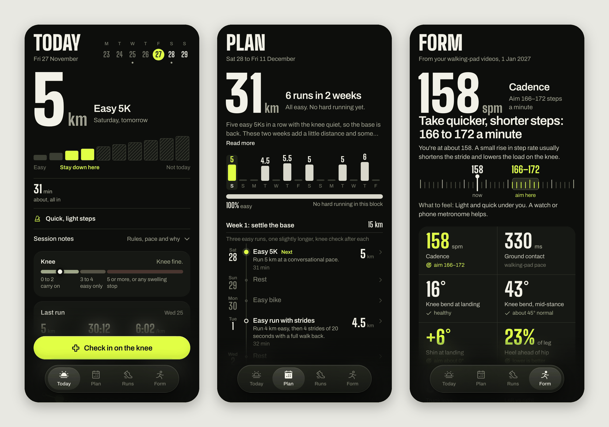

# AI running coach

[](https://github.com/SammyJ3000/ai-running-coach/actions/workflows/ci.yml)

I built a personal running coach to get myself back to my 5K best after a knee injury. It reads my runs from Apple Health, measures my running form from phone video, and uses Claude to write a two week plan, review each run and answer questions. The model writes the plan, but it never has the last word on safety: deterministic knee rules in code check every session before I see it. An LLM as judge eval harness tests the coach for wrong answers and invented facts. It is a phone web app with no build step, two serverless functions and a local Python vision pipeline.



*Screenshots use fictional demo data.*

The runner profile in this repo (Alex) is fictional. This is a personal project, not medical advice. If you are coming back from an injury, follow your physio.

## How it works

```
 iPhone Shortcut (Apple Health samples)      watch screenshot        typed run
            │                                      │                     │
            ▼                                      ▼                     ▼
   POST /api/runs ── lib/runs.js            POST /api/coach        POST /api/runs
   finds runs in the raw samples            { action: 'read' }     { run }
            │                               Claude vision reads
            │                               the numbers as JSON
            └──────────────┬───────────────────────┘
                           ▼
                 runs + knee check ins  (Vercel Blob, or tmp/store locally)
                           │
                           ▼
   POST /api/coach { action: 'plan' | 'review' | 'ask' }
     context = goal (config.json) + recent runs + knee check ins
             + form analysis (form/out/summary.json)
             + numbers block (lib/paces.js: paces, zones, predictions, calculated in code)
     system  = prompts/playbook.md (cached) + prompts/<action>.md
                           │
                           ▼
                Claude (model set in config.json)
                           │  JSON plan
                           ▼
     lib/rules.js enforce(): clamps every session to the knee rules
     and returns a list of what it changed and why
                           │
                           ▼
          stored plan  →  index.html (Today, Plan, Runs, Form)
```

The form analysis runs on my laptop, not on the server:

```
 phone clip (.mov) → form/pose_extract.py (MediaPipe Pose Landmarker, every frame)
                   → form/analyse.py (slow motion detection, gait events, metrics)
                   → form/overlay.py, form/render.py (skeleton video and stills)
                   → form/out/summary.json (cues and metrics the coach reads)
```

## The design decisions that matter

### The LLM proposes, deterministic rules check

The coach writes the plan as JSON. Before it is saved, `enforce()` in `lib/rules.js` walks every session and changes any that break the rules:

- First, `parseModelJson()` (`lib/modeljson.js`) takes the JSON out of the reply and `validatePlan()` checks its shape: weeks of sessions, each with a date, a type and a title, and numbers (or nothing) for distance, minutes and heart rate cap. A reply that fails gets a 502 and is never saved. Run reviews and screenshot readings get the same kind of check.
- No run more than 10% longer than the longest run in the last 30 days, or 3 km if there were none. The check runs over real runs plus the plan's own earlier sessions, so the cap builds week by week inside the plan too. A run planned in minutes only is held to the same cap, turned into minutes at the runner's usual pace (the median of their last ten runs).
- No quality sessions (tempo, intervals, hills, time trials and so on) until three pain free weeks, then at most one a week.
- If the latest knee check in shows swelling, high pain, soreness that lasted 48 hours, or pain above the everyday baseline, every run in the plan becomes a walk, not just that day's. This is deliberately cautious: the plan stays all walking until a better check in and a fresh plan.
- Every run gets a heart rate cap: 76% of max during the comeback, then 79%. A higher cap is clamped and a missing one is added.
- Only the session types in the plan prompt count. A session with any other type, or one labelled rest or cross training whose title reads as a run, is checked as a run.

Each change comes back as a plain sentence, for example `2027-01-10: 8 km → 5.5 km (no run more than 10% longer than your longest in 30 days)`, and the Plan tab shows them. Every session is checked as a run unless it is both labelled and titled as a rest day or cross training (such as a bike ride), so the model cannot word its way past the rules. The prompts tell the model the rules too, so that in practice very little gets cut.

The same split runs through the rest of the app. The model never works out paces or heart rate zones. `lib/paces.js` calculates fitness (VDOT, from the Daniels and Gilbert equations), training paces, race predictions and zones, and the prompts tell the model to quote those numbers. Run detection from raw Apple Health samples is plain code too (`lib/runs.js`).

### Prompt caching

The playbook is the first system block, with a cache breakpoint, and it is byte identical across plan, review and ask. One cached copy serves every call. Everything that changes per call (runs, check ins, the question) goes in the user message after the breakpoint.

### The eval harness

`executions/coach_exam.mjs` is an LLM as judge harness:

- It sends each exam question through the same endpoint the app uses (`POST /api/coach { action: 'ask' }`), so it tests the real prompts, playbook and context, not a copy.
- A separate judge call grades each answer against a model answer and the reference material (the playbook, the runner's profile, the form analysis and `lib/rules.js`). It scores four things, each 0 or 1: correct, cites the right source, no invented facts, and knee safe. A pass needs correct, no invented facts and knee safe.
- The judge is a different model from the coach by default (`judge_model` in `config.json`, or `JUDGE_MODEL` in the environment or `.env`), so the coach never marks its own answers.
- Hallucination traps ask about rules, studies or workouts that don't exist. A good answer says it doesn't know rather than making something up.
- Retest rounds rerun last round's failures plus a seeded random sample of earlier passes, so a fix to the playbook can't quietly break something that used to work.
- It tracks cost per call from the token usage, including cache writes and reads, and logs API errors separately so they never count as wrong answers.
- Each round writes raw answers to `evals/runs/`, a line to `evals/exam-log.md`, and a full table to `evals/exam-results.md`.

There is also a plan level eval that needs no API key and runs in CI: `evals/adversarial-plans.js` is a set of plans built to break the knee rules (a tempo run labelled as cross training, a three hour run in minutes only, running after a bad knee check in and so on), and `tests/adversarial-plans.test.js` checks that `enforce()` brings every one back inside the rules, using its own copy of the rules. `evals/README.md` explains both.

### The vision pipeline

The form analysis uses MediaPipe Pose Landmarker (heavy model) on every frame of an iPhone slow motion clip filmed on a walking pad:

- `pose_extract.py` decodes the clip with ffmpeg at 960 px wide and saves 33 landmarks per frame, with world coordinates and visibility.
- `analyse.py` finds the slow motion section from the gait rhythm and converts frame times to real time, corrects camera roll from vertical lines in the background (OpenCV Hough lines), and detects foot contacts from heel and toe height plus horizontal speed against the belt.
- From the side it measures cadence, ground contact time, knee bend at landing and mid stance, how far the heel lands ahead of the hip, shin angle at landing, trunk lean and vertical movement. From the front or back it measures pelvic drop, knee angle, foot position and arm crossover.
- `overlay.py` and `render.py` draw the skeleton video and labelled stills. `rerender.py` redraws them from the saved analysis without rerunning it, so the numbers never change when the pictures do.

It is a 2D estimate from a phone, not a clinical gait analysis, and the app says so.

## What broke and how it was fixed

These come from the project's build log and eval log.

- **The live "write the plan" call failed with ENOENT on `prompts/plan.md`.** The `.vercelignore` entry for the root `PLAN.md` was not anchored, so it also matched `prompts/plan.md` and the prompt never deployed. Fixed by anchoring root only entries with a leading slash.
- **An evening run on the plan date counted as no run at all.** `longest30` counted runs only up to 12:00 UTC on the plan date, so a run that evening read as "0 km in 30 days". It now counts the whole day.
- **A stored plan told the runner to walk above a heart rate that was higher than the easy cap.** The prompts now tie every "walk if heart rate goes over" line to the session's `hr_cap`, and `enforce()` clamps `hr_cap` itself.
- **The first real plan broke the Today screen.** It had been designed on short sample text. Real sessions came through as a paragraph squeezed beside a large number, and text ran under the tab bar. Today now has three states picked from the data (run done, rest day, run day), and `readSession` in `index.html` reads the coach's sentence ("Run 4 min, walk 1 min, x5") into steps drawn as a shape. Anything it can't read falls back to a simple effort bar.
- **Apple Health had no runs in it.** The watch only records a run when a workout is started, and its phone app needs permission to write to Health. As a backup the app now reads a screenshot of the watch app's run summary with Claude vision, and runs can be typed in.
- **The skeleton overlay carried the wrong branding.** The renderer had my personal brand's wordmark and colours baked in. It now draws in the app's own style, and every video and still was redrawn from the saved analysis with `rerender.py`. The metrics files' checksums were unchanged.
- **The first full eval round found invented facts.** Round 1 on the private exam (84 questions) passed 78, with 4 answers containing invented facts and none unsafe. After three rounds of playbook fixes, each retesting the failures plus 10 random earlier passes, every question's latest graded answer passed. The API credit ran out during round 4, so there was no fresh full run after the last edits. Total spend was about $15.50.

## What is not in this repo

- **The real playbook.** The coach's private playbook was distilled from published running books, so it is not included. `prompts/playbook.md` is a short placeholder in my own words with general running guidance. Swap in your own.
- **The real exam.** Those questions were written from the same books. `evals/exam.md` has seven original example questions in the same format, including two hallucination traps, so the harness still runs.
- **Personal data.** No real runs, health data, gait videos or landmarks. `config.json` and `form/example-summary.json` are fictional examples.
- **Design tooling.** The screenshot and icon sheet scripts I used while designing the app.

## Setup and run

You need Node 22 or later. The form pipeline also needs Python 3.12 and ffmpeg.

### The app, locally

```bash
npm install
cp .env.example .env          # add ANTHROPIC_API_KEY; APP_KEY is optional locally
npm start                     # node executions/dev-server.js, http://localhost:4322
```

Without an `APP_KEY` in `.env`, the dev server uses a local passphrase and hands it to the page, so it opens straight away. Data is saved as JSON in `tmp/store/`. Add a run by hand on the Runs tab, check in on the knee, then write a plan. Plans, reviews and questions call the Anthropic API and cost credits.

To use your own runner, edit the `goal` block in `config.json`. The models are set there too (`coach_model`, and `judge_model` for the eval judge).

### Tests and lint

```bash
npm test                  # knee rules, adversarial plans, pace maths, run detection, the API handlers
npm run lint              # ESLint on the server code, scripts and tests
cd form && pip install -r requirements-dev.txt && ruff check . && python -m unittest discover tests   # the form scripts and the gait maths
```

The tests need no API key or network, and they write only to a temp folder. GitHub Actions runs all of these on every push and pull request (`.github/workflows/ci.yml`).

### The eval harness

Start the dev server with the local passphrase, then run a round in a second terminal. Every round calls the API for each question twice (coach and judge).

```bash
node executions/dev-server.js --dev-key
node executions/coach_exam.mjs --round 1
node executions/coach_exam.mjs --round 2 --retest 1 --random 3
node executions/coach_exam.mjs --round 3 --only E6,E7
```

### The form pipeline

```bash
cd form
python3.12 -m venv .venv
.venv/bin/pip install -r requirements.txt
mkdir -p models
curl -L -o models/pose_landmarker_heavy.task \
  https://storage.googleapis.com/mediapipe-models/pose_landmarker/pose_landmarker_heavy/float16/latest/pose_landmarker_heavy.task
./run_all.sh /path/to/side.mov:side-right /path/to/back.mov:back --render --stills
.venv/bin/python rerender.py /path/to/side.mov --web   # the clip for the Form tab
```

It was built for 1920 x 1080 iPhone slow motion clips (about four times slowed at 30 fps). Metrics land in `form/out/`. The coach reads `form/out/summary.json`, which you write from those metrics in the format of `form/example-summary.json`. Until it exists, the app uses the example. Optional: put Archivo and Big Shoulders Display (Google Fonts) `.ttf` files in `form/fonts/` for the overlay type.

### Deploy

The app runs on Vercel. Link the folder with `vercel link`, connect a private Blob store, put your keys in `.env` and run `bash executions/push_env.sh` to copy them to the project without printing them, then deploy. `.vercelignore` keeps the eval, form and helper scripts out of the deployment, and `vercel.json` blocks the prompts, `lib/` and config from being served.

To send runs from an iPhone, build the Shortcut in [docs/iphone-shortcut.md](docs/iphone-shortcut.md).

### API

All calls need the `x-app-key` header.

- `GET /api/runs`: runs and knee check ins.
- `POST /api/runs`: `{ samples }` from the Shortcut, `{ run }` typed in, or `{ checkin }` for the knee. `?dry=1` reports what it found without saving.
- `GET /api/coach`: the plan, the rule changes, the knee status, reviews, the goal, the form analysis and the numbers block.
- `POST /api/coach`: `{ action: 'plan' }`, `{ action: 'review', runId }`, `{ action: 'ask', question }` or `{ action: 'read', image }`.

Errors come back as `{ error }` with a status code: 401 for a wrong key, 503 when a key is missing on the server, 502 when the model's reply fails its checks, and 500 with a generic message for anything else (the details stay in the server log).

## Stack

- React 18 and Babel standalone from a CDN, in one `index.html`, with no build step. Installable as a home screen app. One file and no build was a deliberate choice for a one person app: it deploys as static files plus two functions, with nothing to compile.
- Vercel serverless functions in Node 22, with Vercel Blob for storage.
- Anthropic Messages API called with `fetch`, with prompt caching and vision.
- Python with MediaPipe, OpenCV, NumPy, Pillow and ffmpeg for the form analysis.
- Apple Health through an iPhone Shortcut.

## About me

I'm Sam Jordan. I design and build apps and AI tools with Claude Code. More of my work: https://sam-jordan-cv.vercel.app
